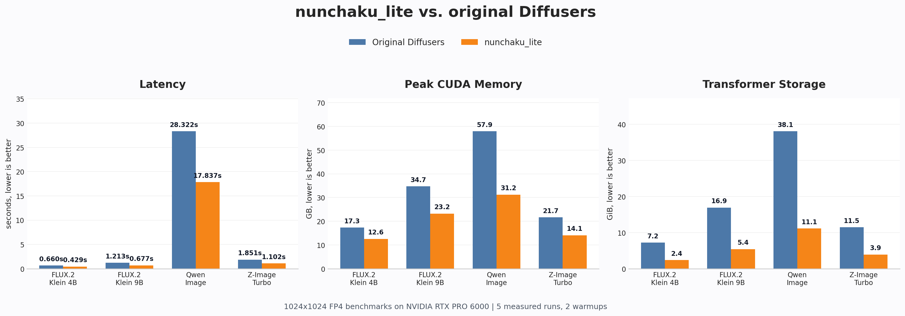

<p align="center">
  
</p>

<p align="center">
  <a href="https://github.com/rootonchair/nunchaku_lite/actions/workflows/cpu-tests.yml">
    
  </a>
  <a href="https://github.com/rootonchair/nunchaku_lite/actions/workflows/wheels.yml">
    
  </a>
  <a href="https://nunchaku-lite.readthedocs.io/en/latest/">
    
  </a>
  <a href="LICENSE">
    
  </a>
</p>

## About

`nunchaku_lite` brings Nunchaku-quantized image generation models to standard
Diffusers pipelines with a lean runtime, native CUDA kernels, and drop-in
pipeline loading. It is designed for fast SVDQ W4A4 inference with a small
integration surface: load a normal Diffusers pipeline, replace only the
quantized component, and keep the rest of the workflow
unchanged.

Its core features include:

- Efficient pipeline loading: constructs the patched component up front so
  Diffusers does not first materialize dense BF16 transformer or UNet weights
  that are immediately replaced.
- Native quantized kernels: packages the CUDA kernels and Python wrappers needed
  for INT4 and FP4 Nunchaku checkpoints.
- AWQ GEMM acceleration: unlike original Nunchaku, `nunchaku_lite` ships a
  native W4A16 group-size-64/int32 GEMM path for large AWQ projections, turning
  chunked GEMV bottlenecks into high-throughput CUDA matmuls.
- Broad image-model coverage: includes built-in adapters for FLUX.1, FLUX.2
  Klein, Qwen-Image, Qwen-Image-Edit, SDXL, SDXL-Turbo, and Z-Image Turbo.
- Runtime LoRA support: exposes Diffusers-style LoRA loading, adapter strength
  control, multi-LoRA composition, and unload/reset flows for supported model
  families.
- Extensible adapter registry: keeps model-specific graph rewrites isolated in
  small adapters without requiring pipeline subclasses or a dependency on the
  full `nunchaku` Python package.

## Benchmarks

<p align="center">
  
</p>

On an NVIDIA RTX PRO 6000, `nunchaku_lite` delivers up
to `1.79x` lower latency, up to `46%` lower peak CUDA memory, and up to `71%`
smaller transformer storage versus unmodified Diffusers pipelines in the current
benchmark set.

See [docs/benchmarks.md](docs/benchmarks.md) for charts, generated samples,
run settings, and reproduction commands.

## Supported Models

`nunchaku_lite` currently supports Diffusers pipelines whose transformer or UNet
component matches one of the built-in adapters below. Checkpoints should be SVDQ
W4A4 Nunchaku v2 `.safetensors` files in INT4 or FP4 format. Full runnable
model guides live under `docs/models/`.

| Model family | Coverage | Runtime LoRA | Guide | Features |
| --- | --- | --- | --- | --- |
| FLUX.1 | FLUX.1-schnell and FLUX.1-dev | Yes | [docs/models/flux.md](docs/models/flux.md) | Pipeline loading, INT4/FP4 checkpoints, Diffusers-format LoRA loading, strength control, multi-LoRA composition, reset, and unload. |
| FLUX.2 Klein | FLUX.2 Klein | Yes | [docs/models/flux2.md](docs/models/flux2.md) | Pipeline loading, INT4/FP4 checkpoints, runtime LoRA, and ComfyUI Flux2 LoRA key conversion. |
| Qwen-Image and Qwen-Image-Edit | Qwen-Image, Qwen-Image-Lightning, Qwen-Image-Edit, and Qwen-Image-Edit-2509 | Yes | [docs/models/qwen_image.md](docs/models/qwen_image.md) | Pipeline loading, INT4/FP4 checkpoints, low-VRAM examples, Lightning LoRA workflows, and edit-pipeline examples. |
| SDXL and SDXL-Turbo | SDXL and SDXL-Turbo | Not yet | [docs/models/sdxl.md](docs/models/sdxl.md) | Pipeline loading for quantized UNet checkpoints. |
| Z-Image Turbo | Z-Image Turbo | Yes | [docs/models/z_image.md](docs/models/z_image.md) | Pipeline loading, INT4/FP4 checkpoints, runtime LoRA, and dense AdaLN modulation LoRA branches. |

The Qwen low-VRAM guides use `enable_model_cpu_offload()`, which requires
`accelerate`.

Additional model families should be added through the adapter registry rather
than pipeline subclasses. See [docs/roadmap.md](docs/roadmap.md) for planned
coverage and remaining feature work.

## Requirements

- Python 3.10 or newer
- PyTorch 2.7 or newer with CUDA
- Diffusers 0.36 or newer

Native source builds also require CUDA toolkit 12.6 or newer with `nvcc`. The
default runtime path uses prebuilt kernels from `rootonchair/nunchaku-lite-kernels`
through the Hugging Face `kernels` library instead.

The native build detects the local GPU architecture by default. Supported
targets are `sm75`, `sm80`, `sm86`, `sm89`, `sm120a`, and `sm121a`, subject to
the installed CUDA toolkit version. CUDA 12.6 or newer is the documented
minimum; `sm120a` requires CUDA 12.8 or newer, and `sm121a` requires CUDA 13.0
or newer. The Hugging Face kernels package provides prebuilt kernels for CUDA
`7.5`, `8.0`, `8.6`, `8.9`, `12.0a`, and `12.1a`.

The root Python package does not compile CUDA code. CUDA toolkit requirements
apply only when installing the local `nunchaku_lite_kernels` package from
`./nunchaku-lite-kernels`.

> **CUDA version note:** `nunchaku_lite` first tries a locally installed
> `nunchaku_lite_kernels` package, then falls back to
> `rootonchair/nunchaku-lite-kernels` through Hugging Face `kernels`.

### Apple silicon (MPS, experimental)

INT4 SVDQ checkpoints also run on Apple-silicon GPUs with `device="mps"`.
Apple GPUs have no INT4 matmul, so the MPS path runs SVDQ layers as **W8A8**:
the 4-bit weights (plus folded group scales) become int8, activations are
quantized to int8 per token after smoothing, and the matmul runs on the M5
Neural Accelerators with the SVD low-rank branch, scales and bias fused into
the kernel epilogue. Q/K RMSNorm and RoPE run in a fused Metal kernel.

- Requires macOS 26+ and a PyTorch build with MPS. With PyTorch 2.10 to 2.15 the
  Metal kernels download from the Hugging Face Hub on first use (the `kernels`
  dependency of `nunchaku-lite`). For other PyTorch versions, build them
  locally: `pip install --no-build-isolation ./nunchaku-lite-kernels`
- Choose the quantized-kernel backend with `backend=` on `load_nunchaku_pipeline`
  or `patch_transformer` (the same keyword Diffusers uses for kernel selection in
  `AutoRoundConfig`; unrelated to `set_attention_backend`). CUDA has a single
  kernel and accepts only `"auto"`.
  - `"auto"` (default): `"int8"` when the transformer fits in half of the GPU
    working set with int8 weights, otherwise `"int4"`; `"dense"` on Apple GPUs
    without Neural Accelerators (pre-M5).
  - `"int8"`: fastest. `"int4"`: weights stay 4-bit in memory, a few percent
    slower, identical output. `"dense"`: exact dequantized fallback (more
    memory, no speedup).

  ```python
  pipe = load_nunchaku_pipeline(..., device="mps", backend="int4")
  ```
- INT4 checkpoints only (no NVFP4). Verified end to end with FLUX.2 Klein 4B.
  The FLUX.1, Qwen-Image, and Z-Image adapters use the same code paths but are
  not yet verified on MPS.

On an M5 MacBook Pro (FLUX.2 Klein 4B, 4 steps, denoising only):

| Transformer | Weights | Live GPU memory (1024px) | Step 512px | Step 1024px |
| --- | --- | --- | --- | --- |
| Dense BF16 | 7.75 GB | 8.1 GB | 1.20 s | 4.96 s |
| INT4, `int8` backend (default) | 4.57 GB | 5.6 GB | 0.62 s (1.94x) | 2.27 s (2.19x) |
| INT4, `int4` backend | 2.67 GB | 4.4 GB | 0.70 s (1.71x) | 2.50 s (1.98x) |

The packed checkpoint `qweight` is released after conversion whenever the
kernel copy reproduces it exactly (117 of 120 layers for `int8`, all layers for
`int4`); `state_dict()` re-packs it and `load_state_dict()` restores it.
On M5-class GPUs the patched transformer's attention also runs on the Neural Accelerators (MLX's flash
attention kernel) instead of PyTorch's MPS attention, and FLUX.2's q/k norm + RoPE is one fused kernel. Both
come with the Hub kernels; with an older Hub build they are compiled at runtime instead. The dense BF16 row uses
stock Diffusers.

There is also an MLX runtime, `nunchaku_lite.mlx` (`pip install "nunchaku-lite[mlx]" mflux`),
which loads the same checkpoints into [mflux](https://github.com/filipstrand/mflux)
pipelines with the same `load_nunchaku_pipeline` interface. See
[docs/mlx.md](docs/mlx.md).

## Installation

Install from source:

```bash
pip install .          # PyTorch runtime (CUDA, Apple MPS) for Diffusers pipelines
pip install ".[mlx]"   # adds the MLX runtime (Apple silicon) for mflux pipelines
```

This installs the root Python runtime and uses Hugging Face prebuilt kernels by
default. `nunchaku_lite.mlx` does not import torch, even though the base install
includes it.

To build and use the local CUDA kernels package:

```bash
pip install --no-build-isolation ./nunchaku-lite-kernels
```

`--no-build-isolation` ensures the extension is compiled against the PyTorch
version installed in the active environment.

When `nunchaku_lite_kernels` is installed locally, `nunchaku_lite` prefers it
over the Hugging Face fallback.

Build and install a wheel:

```bash
python setup.py bdist_wheel
pip install dist/nunchaku_lite-*.whl
```

By default, the local kernels package build uses `NUNCHAKU_INSTALL_MODE=FAST`
and compiles for visible local CUDA devices. To build all supported
architectures:

```bash
NUNCHAKU_INSTALL_MODE=ALL pip install --no-build-isolation ./nunchaku-lite-kernels
```

## Quick Start

Run from the repository root:

```python
from pathlib import Path

import torch
from diffusers import FluxPipeline

from nunchaku_lite import load_nunchaku_pipeline


model_id = "black-forest-labs/FLUX.1-schnell"
precision = "fp4"  # "int4" or "fp4"
checkpoints = {
    "int4": "nunchaku-ai/nunchaku-flux.1-schnell/svdq-int4_r32-flux.1-schnell.safetensors",
    "fp4": "nunchaku-ai/nunchaku-flux.1-schnell/svdq-fp4_r32-flux.1-schnell.safetensors",
}
output_path = Path(f"outputs/flux_schnell_nunchaku_lite_{precision}.png")

pipe = load_nunchaku_pipeline(
    model_id,
    pipeline_cls=FluxPipeline,
    checkpoint=checkpoints[precision],
    target="flux",
    precision=precision,
    torch_dtype=torch.bfloat16,
    device="cuda",
)
pipe = pipe.to("cuda")

image = pipe(
    "A cat holding a sign that says hello world",
    height=1024,
    width=1024,
    num_inference_steps=4,
    guidance_scale=0.0,
    generator=torch.Generator(device="cuda").manual_seed(12345),
).images[0]

output_path.parent.mkdir(parents=True, exist_ok=True)
image.save(output_path)
print(f"saved {output_path}")
```

### Runtime LoRA

Pipelines loaded with `load_nunchaku_pipeline` expose Diffusers-style LoRA
methods when the selected adapter supports runtime LoRA:

```python
from pathlib import Path

import torch
from diffusers import FluxPipeline

from nunchaku_lite import load_nunchaku_pipeline


model_id = "black-forest-labs/FLUX.1-dev"
precision = "fp4"
checkpoint = "nunchaku-tech/nunchaku-flux.1-dev/svdq-fp4_r32-flux.1-dev.safetensors"
output_path = Path("outputs/flux_dev_ghibsky_lora_fp4.png")

pipe = load_nunchaku_pipeline(
    model_id,
    pipeline_cls=FluxPipeline,
    checkpoint=checkpoint,
    target="flux",
    precision=precision,
    torch_dtype=torch.bfloat16,
)
pipe.enable_model_cpu_offload()

pipe.load_lora_weights(
    "aleksa-codes/flux-ghibsky-illustration",
    weight_name="lora.safetensors",
    adapter_name="ghibsky",
)
pipe.set_adapters("ghibsky", adapter_weights=0.75)

image = pipe(
    "GHIBSKY style painting of a cozy mountain cabin beside a clear lake at sunset",
    height=1024,
    width=1024,
    num_inference_steps=28,
    guidance_scale=3.5,
    generator=torch.Generator(device="cpu").manual_seed(12345),
).images[0]

output_path.parent.mkdir(parents=True, exist_ok=True)
image.save(output_path)
print(f"saved {output_path}")
```

Checkpoint paths can be local `.safetensors` files or Hugging Face paths of the
form:

```text
org-or-user/repo-name/path/to/checkpoint.safetensors
```

## Documentation

| Topic | Link |
| --- | --- |
| Hosted documentation | [nunchaku-lite.readthedocs.io](https://nunchaku-lite.readthedocs.io/en/latest/) |
| Benchmark charts and samples | [docs/benchmarks.md](docs/benchmarks.md) |
| Public API and runtime LoRA usage | [docs/api.md](docs/api.md) |
| Development, testing, and adapter authoring | [docs/development.md](docs/development.md) |
| Documentation deployment flow | [docs/deployment.md](docs/deployment.md) |
| Release wheel build flow | [docs/release_wheels.md](docs/release_wheels.md) |
| Supported models and feature backlog | [docs/roadmap.md](docs/roadmap.md) |
| Benchmarks | [benchmarks/README.md](benchmarks/README.md) |

## Public API

```python
from nunchaku_lite import (
    TransformerAdapter,
    list_adapters,
    load_nunchaku_pipeline,
    patch_transformer,
    register_adapter,
)
```

`load_nunchaku_pipeline(...)` is the preferred entry point for normal pipeline
loading. Use `patch_transformer(...)` only when a Diffusers component has already
been constructed and needs in-place patching.

See [docs/api.md](docs/api.md) for argument details, runtime LoRA examples, and
adapter registry usage.

## Development

Run the unit tests:

```bash
pytest -q tests
```

Build the extension in place:

```bash
python setup.py build_ext --inplace
```

See [docs/development.md](docs/development.md) for full inference tests, adapter
authoring guidance, runtime LoRA implementation notes, and repository layout.

## License

`nunchaku_lite` is licensed under the Apache License, Version 2.0. See
[LICENSE](LICENSE).

## Acknowledgements

`nunchaku_lite` builds on the Nunchaku project and uses selected native kernel
code for the lite runtime. We are grateful to the maintainers and contributors
of these projects.
