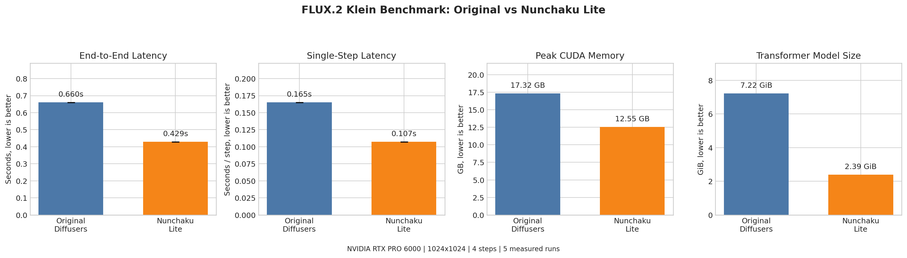
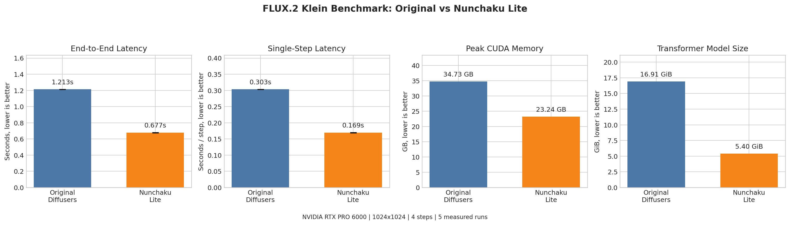
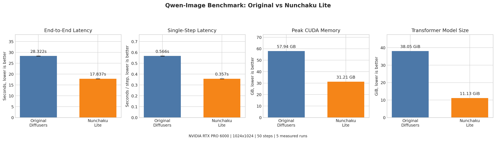

# Benchmarks

`nunchaku_lite` reduces transformer storage and peak CUDA memory while keeping
the normal Diffusers pipeline workflow. The measurements below compare
unmodified Diffusers pipelines against `nunchaku_lite` pipelines loaded with
FP4 SVDQ checkpoints.

All runs used `1024x1024` generation on an NVIDIA RTX PRO 6000, BF16 runtime dtype, 5 measured runs, and 2 warmup runs. Source data is
stored under `outputs/benchmark_*/summary.json`.

## Results

| Model | Steps | Latency | Speedup | Peak CUDA memory | Transformer storage |
| --- | ---: | ---: | ---: | ---: | ---: |
| FLUX.2 Klein 4B | 4 | `0.660s -> 0.429s` | `1.54x` | `17.32 GB -> 12.55 GB` | `7.22 GiB -> 2.39 GiB` |
| FLUX.2 Klein 9B | 4 | `1.213s -> 0.677s` | `1.79x` | `34.73 GB -> 23.24 GB` | `16.91 GiB -> 5.40 GiB` |
| Qwen-Image | 50 | `28.322s -> 17.837s` | `1.59x` | `57.94 GB -> 31.21 GB` | `38.05 GiB -> 11.13 GiB` |
| Z-Image Turbo | 8 | `1.851s -> 1.102s` | `1.68x` | `21.67 GB -> 14.07 GB` | `11.46 GiB -> 3.91 GiB` |

Across this benchmark set, `nunchaku_lite` reaches up to `1.79x` lower latency,
up to `46%` lower peak CUDA memory, and up to `71%` smaller transformer
storage.

## FLUX.2 Klein 4B



Prompt:

```text
A cat holding a sign that says This is Nunchaku Lite
```

| Original Diffusers | nunchaku_lite |
| --- | --- |
|  |  |

## FLUX.2 Klein 9B



Prompt:

```text
A cat holding a sign that says This is Nunchaku Lite
```

| Original Diffusers | nunchaku_lite |
| --- | --- |
|  |  |

## Qwen-Image



Prompt:

```text
A coffee shop entrance features a chalkboard sign reading "This is Nunchaku Lite"
```

| Original Diffusers | nunchaku_lite |
| --- | --- |
|  |  |

## Z-Image Turbo


Prompt:

```text
a cinematic photo of a glass greenhouse full of tropical plants during golden hour, detailed, natural light
```

| Original Diffusers | nunchaku_lite |
| --- | --- |
|  |  |

## Apple silicon (M5, 24 GB)

End-to-end checks on an M5 MacBook Pro (24 GB, AC power, 1024x1024). Step times
are per denoising step. On PyTorch MPS the text encoder was freed after
encoding, and memory is the MPS driver's total after generation. On MLX the
base pipeline supplies only the text encoder and VAE, and peaks include them.

PyTorch MPS:

| Model | Checkpoint | Steps | Step time | Memory |
| --- | --- | ---: | ---: | ---: |
| FLUX.2 Klein 9B | `lite-infer/flux.2-klein-9b-nunchaku-lite-int4-r32` | 4 | 7.6 s (int8), 8.1 s (int4) | 11.5 GB (int8), 6.3 GB (int4) |
| FLUX.1-dev | `nunchaku-tech/nunchaku-flux.1-dev` INT4 r32 | 20 | 8.5 s | 9.3 GB |
| FLUX.1-dev | `lite-infer/flux.1-dev-nunchaku-lite-int4-r32` | 20 | 6.4 s (int4) | 13.4 GB |
| Z-Image Turbo | `nunchaku-tech/nunchaku-z-image-turbo` INT4 r128 | 8 | 4.35 s (int8) | 14.1 GB |
| Qwen-Image Lightning | `nunchaku-tech/nunchaku-qwen-image` INT4 r32, 4-step | 4 | 6.2-6.8 s (int4) | 26.5 GB |

MLX (mflux pipelines; mflux q4 for comparison where it fits):

| Model | Checkpoint | Steps | Step time | Peak memory | mflux q4 |
| --- | --- | ---: | ---: | ---: | ---: |
| FLUX.2 Klein 4B | `lite-infer/flux.2-klein-4b-nunchaku-lite-int4-r32` | 4 | 2.69 s (int8), 2.87 s (int4) | 7.8 GB (int8), 5.9 GB (int4) | 3.25 s, 5.5 GB |
| FLUX.2 Klein 9B | `lite-infer/flux.2-klein-9b-nunchaku-lite-int4-r32` | 4 | 4.6-5.7 s (int8), 5.1-5.9 s (int4) | 16.4 GB (int8), 11.2 GB (int4) | 6.97 s, 10.3 GB |
| FLUX.1-dev | `lite-infer/flux.1-dev-nunchaku-lite-int4-r32` | 20 | 7.45-7.9 s (int4) | 22.7 GB | 11.48 s, 21.8 GB |
| Z-Image Turbo | `nunchaku-tech/nunchaku-z-image-turbo` INT4 r128 | 8 | 3.86 s | 12.4 GB | not measured |
| Qwen-Image Lightning | `nunchaku-tech/nunchaku-qwen-image` INT4 r32, 4-step | 4 | 24 s (int4, swapping) | 30.1 GB | not measured |

Qwen-Image does not fit in 24 GB: on MPS the first step of each image swaps
(30-70 s; the steady-state steps are shown), and on MLX mflux keeps the bf16
text encoder (about 16 GB) resident, so every step swaps. On 24 GB, cap MLX's
buffer cache (`mx.set_cache_limit(1 << 30)`): otherwise up to 9 GB of freed
buffers stay resident in the Klein 9B pipeline and the first step of every image
swaps. `backend="auto"` picks int4 where int8 would not fit (Klein 9B, FLUX.1-dev,
Qwen-Image).

## Reproducing

The benchmark scripts live under `benchmarks/`. Each script writes generated
images, a `summary.json`, and, when both Diffusers and `nunchaku_lite` are run,
a `comparison.png` chart.

```bash
python benchmarks/benchmark_qwen_image.py \
  --model-id Qwen/Qwen-Image \
  --checkpoint nunchaku-tech/nunchaku-qwen-image/svdq-fp4_r32-qwen-image.safetensors \
  --precision fp4 \
  --dtype bf16 \
  --runs 5 \
  --warmup-runs 2
```
